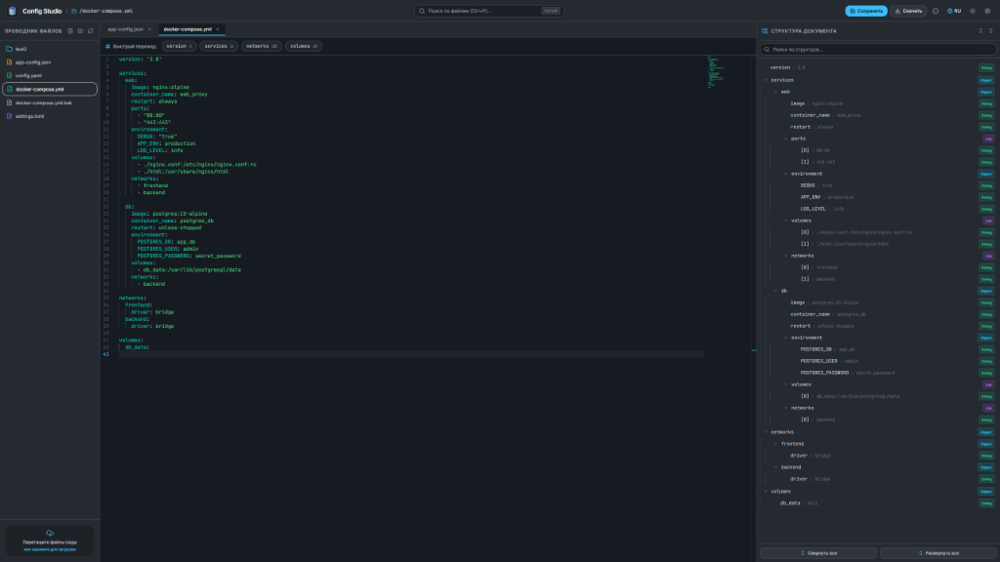
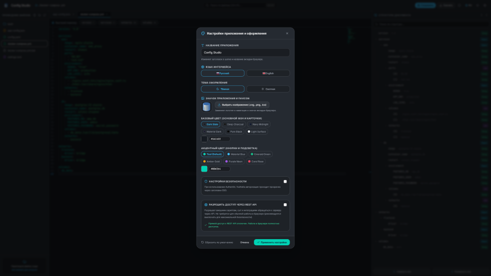

# Config Editor 🚀

[](https://github.com/EdvardBaldanov/Config-Editor/actions/workflows/build.yml)
[](https://github.com/EdvardBaldanov/Config-Editor/releases)
[](https://opensource.org/licenses/MIT)

> [🇷🇺 Описание на русском](#-config-editor-на-русском) | [🇬🇧 English version below](#-config-editor-english)

---

## 🇷🇺 Config Editor (На русском)

Современный, легкий веб-редактор конфигурационных файлов со встроенным ядром **Monaco Editor** (как в VS Code), интерактивной картой структуры документа (**AST Map**), динамическим изменением ширины панелей и гибкой кастомизацией тем и брендинга.

Поставляется в виде **единого бинарного файла** под **Linux** и **Windows** без необходимости устанавливать Node.js, базы данных или другие внешние зависимости.

### 📸 Скриншоты интерфейса


*Главное окно: проводник файлов, редактор с вкладками, быстрый переход по тегам и AST-карта структуры документа.*


*Окно настроек: смена названия и иконки приложения, выбор палитры Base & Accent, язык интерфейса, параметры авторизации и управление REST API.*

---

### ✨ Ключевые возможности

- **Ядро редактора Monaco Editor:**
  - Полноценный движок VS Code с подсветкой синтаксиса YAML, JSON, TOML, INI, Shell, Markdown, Dockerfile и др.
  - Автоматическая адаптация размера редактора при изменении ширины панелей.
- **Интерактивная карта структуры документа (AST Map):**
  - Иерархическое дерево с бейджами типов данных (`Object`, `List`, `String`, `Boolean`, `Number`, `Section`).
  - Быстрый переход к строке кода кликом по элементу дерева.
  - Поиск по структуре с подсчетом совпадений (`X из Y`) и стрелками перехода.
  - Кнопки «Свернуть все» и «Развернуть все».
  - **Плавное изменение ширины панели** перетаскиванием левой границы (двойной клик сбрасывает на 320px, запоминает ширину в `localStorage`).
  - Облако тегов корневых разделов под вкладками с поддержкой горизонтальной прокрутки колесиком мыши.
- **Мультивкладочность и управление файлами:**
  - Открытие нескольких файлов во вкладках с индикатором несохраненных изменений.
  - Диалоговое окно подтверждения закрытия при наличии правок.
  - Быстрый поиск и переключение между файлами (**Ctrl+P**).
  - Проводник файлов: создание, удаление, переименование файлов и папок, Drag-and-drop загрузка.
  - Свойства файла: подсчет SHA-256 хеша с кнопкой копирования, статистика по строкам и символам.
  - Локальная история правок сессии с просмотром diff и восстановлением любой версии.
- **Брендинг, стили и локализация:**
  - Динамическая смена названия программы (обновляет заголовок и название вкладки браузера).
  - Загрузка собственного логотипа (.svg, .png, .ico, .webp) — меняет логотип и favicon.
  - Выбор палитры базового цвета (фон) и акцентного цвета (кнопки, курсор) с авто-контрастом шрифта.
  - Темная и светлая темы оформления.
  - Мультиязычный интерфейс (**Русский** и **English**).
- **Безопасность:**
  - Встроенный экран авторизации (парольная защита).
  - Поддержка SSO-прокси (Authentik, Authelia и Traefik) через HTTP-заголовки.
  - Отключаемый REST API с генератором секретных ключей `X-API-Key`.
- **Единый переносимый бинарник:**
  - Полностью статический исполняемый файл (`CGO_ENABLED=0`).
  - Фронтенд встроен внутрь бинарника (`go:embed`).
  - Автоматическая установка в качестве службы Linux (`-install` / `-uninstall`) с автоопределением **systemd** и **OpenRC**.
- **Модульная система плагинов (Plugin System):**
  - **Изменение интерфейса**: добавление кастомных кнопок в тулбар, элементов в шапку и сплит-панелей (split screen).
  - **Гибридная установка (3 способа)**:
    1. Drag-and-drop `.zip` архива через графический интерфейс (вкладка «Плагины» в настройках).
    2. Установка по ссылке (URL архива или ссылка на репозиторий GitHub).
    3. Прямое копирование папки в каталог `data/plugins/<имя_плагина>/`.
  - **Безопасное выполнение команд на хосте**:
    - Безусловная блокировка деструктивных команд (`rm -rf /`, `mkfs`, форматирование дисков, выключение сервера).
    - Всплывающее окно подтверждения выполнения системных команд.
    - Переключатель «Режим повышенных привилегий («Я знаю, что делаю»)» для доверенного окружения.
  - **Каталог официальных плагинов (1-клик установка)**:
    - 🌐 **[config-studio-web-devkit](https://github.com/EdvardBaldanov/config-studio-web-devkit)**: Живой предпросмотр HTML/PHP в сплит-панели с эмуляцией мобильных устройств, сниппетами Monaco и запуском встроенного веб-сервера (`php -S`).
    - 🖥️ **[config-studio-remote-agent](https://github.com/EdvardBaldanov/config-studio-remote-agent)**: Переключатель серверов в шапке для редактирования файлов на нескольких серверах из единого интерфейса.

---

### 🚀 Быстрый запуск

#### Скачивание готового бинарника
Скачайте бинарник для вашей системы со страницы **[GitHub Releases](https://github.com/EdvardBaldanov/Config-Editor/releases)**:
- **Windows (amd64)**: `config-editor-windows-amd64.exe`
- **Linux (x86_64 / amd64)**: `config-editor-linux-amd64`
- **Linux (ARM64)**: `config-editor-linux-arm64`

#### Запуск на Linux:
```bash
chmod +x config-editor-linux-amd64
./config-editor-linux-amd64 --port 8080 --workdir /etc/yaml-configs
```

#### Автоустановка в качестве службы (Linux systemd / OpenRC):
Бинарник умеет сам устанавливать и настраивать системный демон:
```bash
# Установка сервиса (автоматически определит systemd или OpenRC):
sudo ./config-editor-linux-amd64 -install

# Удаление сервиса:
sudo ./config-editor-linux-amd64 -uninstall
```

#### Запуск на Windows:
```powershell
.\config-editor-windows-amd64.exe -port 8080 -workdir C:\configs
```
После запуска откройте в браузере: `http://localhost:8080` (или `http://<IP-сервера>:8080`).

---

### 🛠️ Сборка из исходников

#### Требования:
- **Go 1.22+**
- **Node.js 20+** & **npm**

```bash
# 1. Клонирование репозитория
git clone https://github.com/EdvardBaldanov/Config-Editor.git
cd Config-Editor

# 2. Сборка веб-интерфейса
cd web
npm install
npm run build
cd ..

# 3. Компиляция бинарника
# Для Linux:
CGO_ENABLED=0 GOOS=linux GOARCH=amd64 go build -ldflags="-s -w" -o bin/config-editor ./cmd/server

# Для Windows:
go build -ldflags="-s -w" -o bin/config-editor.exe ./cmd/server
```

---

### ⚙️ Флаги запуска и переменные окружения

| Флаг | Переменная окружения | По умолчанию | Описание |
|---|---|---|---|
| `--port` | `CONFIG_PORT` | `8080` | Порт HTTP сервера |
| `--workdir` | `CONFIG_WORKDIR` | `./data/configs` | Папка с редактируемыми конфигами |
| `--data` | `CONFIG_DATADIR` | `./data` | Папка для настроек, логотипов и сессий |
| `--auth-user` | `CONFIG_AUTH_USER` | `""` | Логин базовой авторизации |
| `--auth-pass` | `CONFIG_AUTH_PASS` | `""` | Пароль авторизации |
| `-install` | — | `false` | Установить как службу systemd/OpenRC (Linux) |
| `-uninstall` | — | `false` | Удалить службу systemd/OpenRC (Linux) |

---
---

<a name="english-version"></a>
## 🇬🇧 Config Editor (English)

Modern, lightweight web-based configuration editor powered by **Monaco Editor** (VS Code core), interactive document structure map (**AST Map**), draggable resizable sidebars, and customizable branding.

Shipped as a **single standalone portable binary** for **Linux** and **Windows** with zero external runtime dependencies (no Node.js or databases needed at runtime).

### 📸 Screenshots


*Main Workspace: file explorer, multi-tab editor, quick jump tag cloud, and AST structure map.*


*Settings: application title & favicon, Base & Accent color palettes, language switch, security credentials, and REST API management.*

---

### ✨ Features

- **Monaco Editor Core:** Full VS Code editor experience with syntax highlighting for YAML, JSON, TOML, INI, Shell, Markdown, and Dockerfile.
- **Interactive Structure Outline (AST Map):**
  - Hierarchical tree navigation with data type badges (`Object`, `List`, `String`, `Boolean`, `Number`, `Section`).
  - Click any node to instantly jump to the corresponding code line.
  - Search within outline with match counter (`X of Y`) and navigation arrows.
  - One-click "Collapse All" / "Expand All" controls.
  - **Draggable resizable panel width** (double-click resets to default 320px, state remembered in `localStorage`).
  - Horizontal scrollable quick jump root tag cloud.
- **Multi-Tab File Management:**
  - Tabbed editing with dirty indicators.
  - Unsaved changes confirmation dialog.
  - Quick File Switcher / Search (**Ctrl+P**).
  - File Explorer with folder navigation, inline create/rename/delete, and drag-and-drop file upload.
  - File properties with instant SHA-256 hash calculation, one-click clipboard copy, and line/char statistics.
  - Session edit history with visual diff preview and single-click revision rollback.
- **Branding & Localization:**
  - Dynamic application title (updates navbar and browser tab `<title>`).
  - Custom logo & favicon upload (.svg, .png, .ico, .webp).
  - Material 3 Base & Accent color pickers with automatic font contrast calculation.
  - Dark and Light theme modes.
  - Dual interface language support (**English** / **Русский**).
- **Security & Access Control:**
  - Built-in login screen with direct password protection.
  - Reverse proxy SSO compatibility (Authentik, Authelia, Traefik).
  - Disableable REST API with secret `X-API-Key` generation.
- **Single Binary Portability:**
  - Statically compiled standalone binary (`CGO_ENABLED=0`).
  - Web UI assets embedded directly into the Go binary (`go:embed`).
  - Built-in service installer (`-install` / `-uninstall`) with auto-detection for **systemd** and **OpenRC**.
- **Modular Plugin System:**
  - **UI Extensibility**: add custom toolbar actions, header dropdowns, and split-screen preview panels.
  - **Hybrid Installation (3-in-1)**:
    1. Drag-and-drop `.zip` upload in Settings modal (Plugins tab).
    2. Install from URL (direct `.zip` link or GitHub repository `https://github.com/user/plugin`).
    3. Direct placement: copy plugin folder into `data/plugins/<id>/` (auto-detected).
  - **Host Command Execution & Security**:
    - Unconditional blacklist blocking destructive operations (`rm -rf /`, `mkfs`, raw disk writes, shutdown/reboot).
    - Interactive confirmation modal for risky commands.
    - "I know what I'm doing" mode to run host processes without prompts.
  - **Official Plugins Catalog (1-click install)**:
    - 🌐 **[config-studio-web-devkit](https://github.com/EdvardBaldanov/config-studio-web-devkit)**: Live split-screen HTML/PHP preview, responsive viewport simulation, Monaco snippets, and live web server runner (`php -S`).
    - 🖥️ **[config-studio-remote-agent](https://github.com/EdvardBaldanov/config-studio-remote-agent)**: Header server switcher to connect to remote Config Studio instances and edit files across machines from a single UI.

---

### 🚀 Quick Start

#### Download Pre-compiled Binary
Grab the latest release from **[GitHub Releases](https://github.com/EdvardBaldanov/Config-Editor/releases)**:
- **Windows (amd64)**: `config-editor-windows-amd64.exe`
- **Linux (x86_64 / amd64)**: `config-editor-linux-amd64`
- **Linux (ARM64)**: `config-editor-linux-arm64`

#### Running on Linux:
```bash
chmod +x config-editor-linux-amd64
./config-editor-linux-amd64 --port 8080 --workdir /etc/yaml-configs
```

#### Self-Installing as a Service (Linux systemd / OpenRC):
```bash
# Auto-detects systemd or OpenRC and registers system daemon:
sudo ./config-editor-linux-amd64 -install

# To uninstall service:
sudo ./config-editor-linux-amd64 -uninstall
```

#### Running on Windows:
```powershell
.\config-editor-windows-amd64.exe -port 8080 -workdir C:\configs
```
Open your browser at `http://localhost:8080`.

---

### 🛠️ Building from Source

#### Prerequisites:
- **Go 1.22+**
- **Node.js 20+** & **npm**

```bash
# 1. Clone repository
git clone https://github.com/EdvardBaldanov/Config-Editor.git
cd Config-Editor

# 2. Build Web Frontend
cd web
npm install
npm run build
cd ..

# 3. Build Go Binary
# For Linux:
CGO_ENABLED=0 GOOS=linux GOARCH=amd64 go build -ldflags="-s -w" -o bin/config-editor ./cmd/server

# For Windows:
go build -ldflags="-s -w" -o bin/config-editor.exe ./cmd/server
```

---

### ⚙️ Command Line Flags & Environment Variables

| Flag | Environment Variable | Default | Description |
|---|---|---|---|
| `--port` | `CONFIG_PORT` | `8080` | HTTP port to listen on |
| `--workdir` | `CONFIG_WORKDIR` | `./data/configs` | Working directory containing config files |
| `--data` | `CONFIG_DATADIR` | `./data` | Directory for persistent settings and icons |
| `--auth-user` | `CONFIG_AUTH_USER` | `""` | Basic Auth username (disabled if empty) |
| `--auth-pass` | `CONFIG_AUTH_PASS` | `""` | Basic Auth password |
| `-install` | — | `false` | Install as systemd/OpenRC service (Linux) |
| `-uninstall` | — | `false` | Uninstall systemd/OpenRC service (Linux) |

---

## 📄 License
MIT License.
